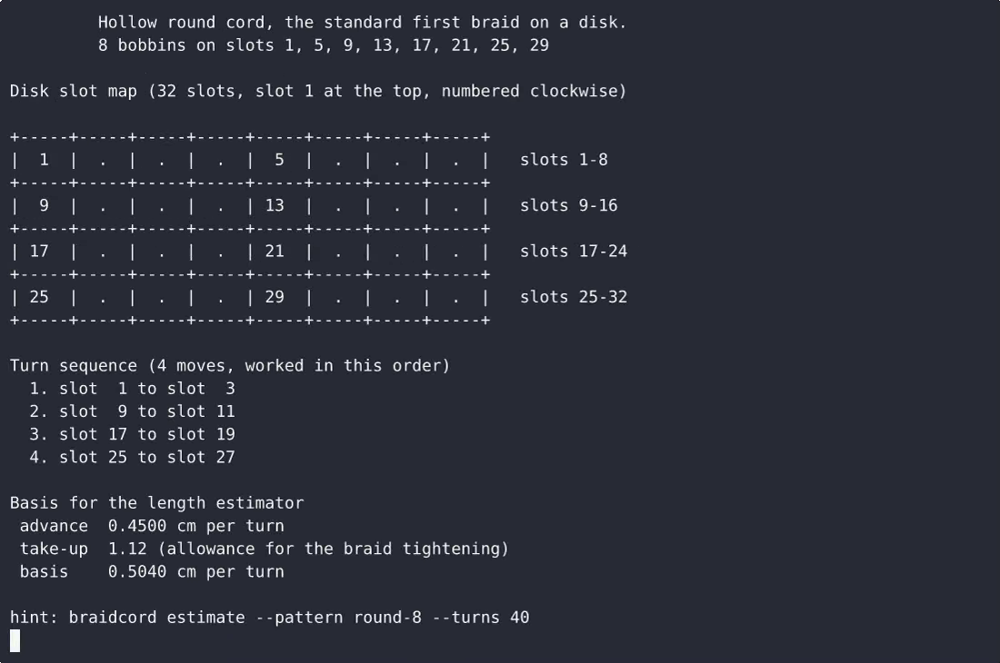
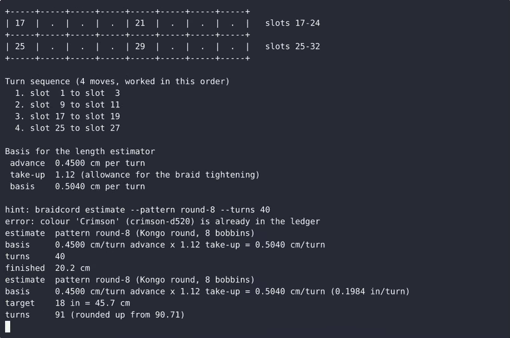

# BraidCord — complete Full-stack app command-line tool example app

This repository contains the complete source for **BraidCord**, an open-source command-line tool built with Full-stack app. BraidCord is a single-file, standard-library-only Python command-line tool for Kumihimo braiders. Everything BraidCord needs to run is here — code, seed data, install scripts. Apache-2.0-licensed — use BraidCord commercially, self-host it, or [remix BraidCord on cenius.ai](https://cenius.ai/marketplace/p/braidcord?ref=gh&utm_campaign=braidcord-webapp) to make it yours.


[](LICENSE)  [](https://cenius.ai)

[](https://cenius.ai/marketplace/p/braidcord?ref=gh&utm_campaign=braidcord-webapp)

> **▶ [Open & edit in cenius.ai](https://cenius.ai/marketplace/p/braidcord?ref=gh&utm_campaign=braidcord-webapp)** — one click to an editable workspace: describe changes in plain English, get an instant preview, one-click deploy and host. Modifications made on the platform come with full rebrand & relicense rights.

_Local clone? See [Quick start](#quick-start) below. cenius.ai is the zero-setup path._

## Demo


📽 **[Demo video on cenius.ai](https://cenius.ai/marketplace/p/braidcord?ref=gh&utm_campaign=braidcord-webapp)** — the complete run-through · [MP4](.github/media/demo.mp4)

## Screenshots

 

## Features

- Braid pattern reference by disk slot
- Thread colour sequence ledger
- Named braid setups
- Finished length estimator from disc turns
- Input validation and safe local persistence

## Quick start

```bash
./install.sh   # installs dependencies + seeds demo data
```

See [`INSTALL.md`](INSTALL.md) for full setup and usage instructions.

## Architecture

No external services required: the entire command-line tool runs from this Full-stack app repo (26 files). Top-level layout: `tests/`. `install.sh` provisions dependencies and seeds demo data so the app starts with something real to explore. See [`INSTALL.md`](INSTALL.md) for complete setup instructions.

## Usage guide

Five walkthroughs, one per feature. All commands assume you are in the project
directory; add `--data-dir ./demo-data` to any of them to play against the demo
store instead of `~/.braidcord`.

### 1. Look up a braid pattern by disk slot

```bash
python3 braidcord.py patterns
```

The table lists every built-in structure with its id, bobbin count and advance
per turn. Then open one:

```bash
python3 braidcord.py pattern round-8
```

```
pattern  round-8  Kongo round
         Hollow round cord, the standard first braid on a disk.
         8 bobbins on slots 1, 5, 9, 13, 17, 21, 25, 29

Disk slot map (32 slots, slot 1 at the top, numbered clockwise)

+-----+-----+-----+-----+-----+-----+-----+-----+
|  1  |  .  |  .  |  .  |  5  |  .  |  .  |  .  |   slots 1-8
...
```

* Used slots show their slot number; every unused slot is a dot.
* The numbered list under the map is one turn, in the order the moves are
  worked: `1. slot  1 to slot  3`.
* The footer prints the advance per turn and the take-up factor, so the
  estimator's number is auditable.

Built-in ids: `round-8`, `square-8`, `spiral-8`, `flat-16`, `kongo-4`.

### 2. Keep a thread colour ledger

```bash
python3 braidcord.py colors add Crimson --hex B3122E --brand Silk
python3 braidcord.py colors add Navy --hex 1B2A4A --notes "waxed linen"
python3 braidcord.py colors
```

```
Colour ledger (2 threads)

id            name     hex     brand
------------  -------  ------  -----
crimson-3f2a  Crimson  B3122E  Silk
navy-81b0     Navy     1B2A4A  -
```

_Full guide: [`USAGE.md`](USAGE.md)_

## FAQ

### Can I deploy BraidCord on my own infrastructure?

Everything you need ships in this repo: clone it, run `./install.sh` to install dependencies and seed demo data, then follow [`INSTALL.md`](INSTALL.md) to start it. No external services required.

### Can I rebrand or white-label BraidCord?

Yes — and the easiest way is [remixing it on cenius.ai](https://cenius.ai/marketplace/p/braidcord?ref=gh&utm_campaign=braidcord-webapp): modifications made on the platform come with full rebrand and relicense rights over your derivative.

### Which framework or language does BraidCord use?

Powered by Full-stack app. This repo is the real thing — full source, seed data, and all — ready to clone and start up. Highlights include input validation and safe local persistence.

### Can non-developers customise BraidCord?

Describe what you want changed on [cenius.ai](https://cenius.ai/marketplace/p/braidcord?ref=gh&utm_campaign=braidcord-webapp) — no code editing needed; the platform produces a fresh build you can download and deploy.

### What license does BraidCord use?

Yes. The code is Apache-2.0-licensed — use it, modify it, and ship it commercially. See [LICENSE](LICENSE).

## License & rebranding

Released under the [Apache License 2.0](LICENSE) (© 2026 Cenius AI) — free for personal and commercial use. The Cenius name/logo are trademarks (see NOTICE).

**Need a customized version?** [Remix this app on cenius.ai](https://cenius.ai/marketplace/p/braidcord?ref=gh&utm_campaign=braidcord-webapp) — modifications made on the platform come with **full rebrand & relicense rights** over your derivative.

## Built with cenius.ai

This entire application — code, design, seeded demo data — was generated on **[cenius.ai](https://cenius.ai)** from a plain-English description.

- 🚀 [Build your own app on cenius.ai](https://cenius.ai)
- 🎛️ [Remix BraidCord on the marketplace](https://cenius.ai/marketplace/p/braidcord?ref=gh&utm_campaign=braidcord-webapp) — open it in a workspace, prompt for changes, and ship your own version.

More open-source apps: [the Cenius-ai catalog](https://github.com/Cenius-ai) · [showcase index](https://github.com/Cenius-ai/showcase)
